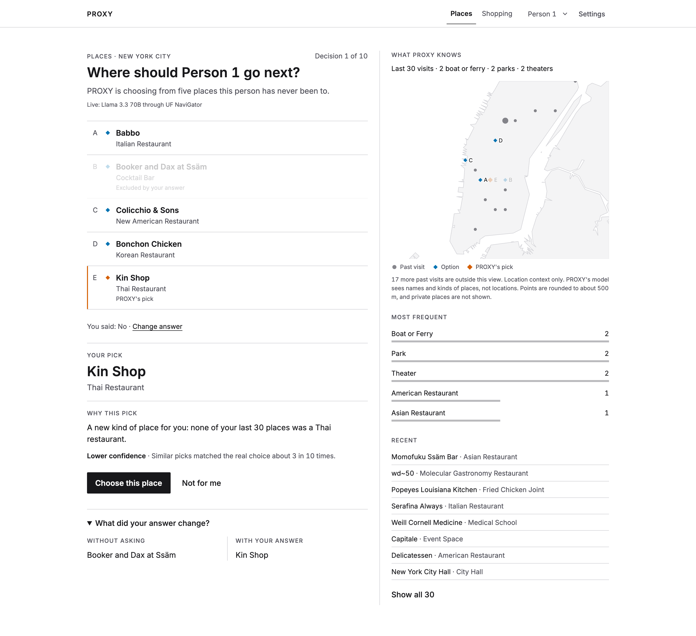
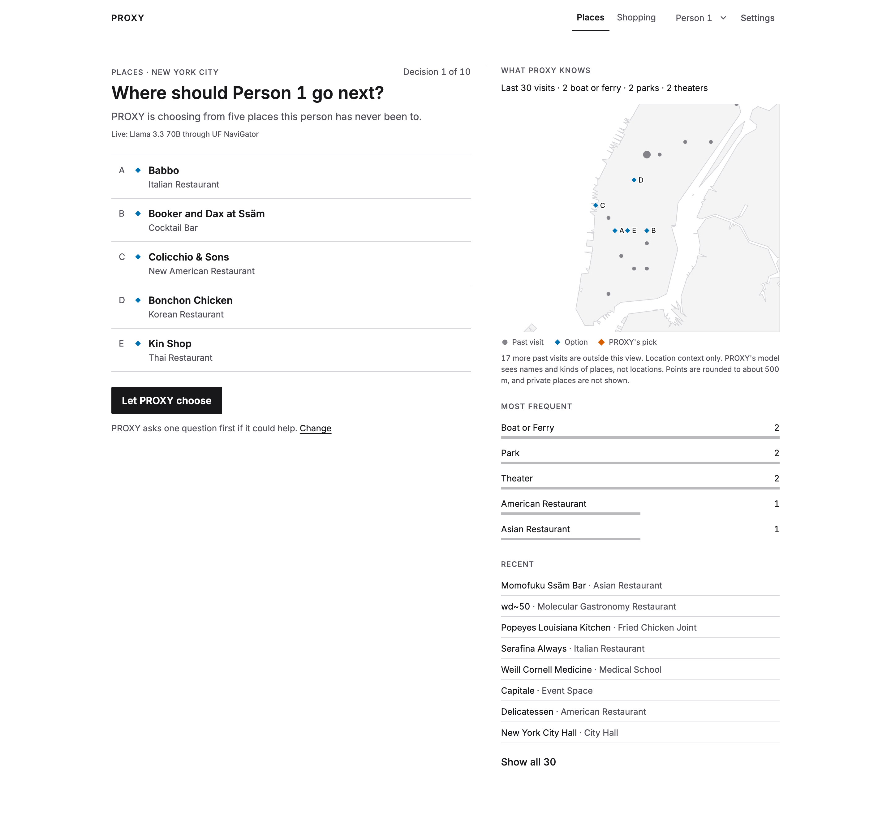
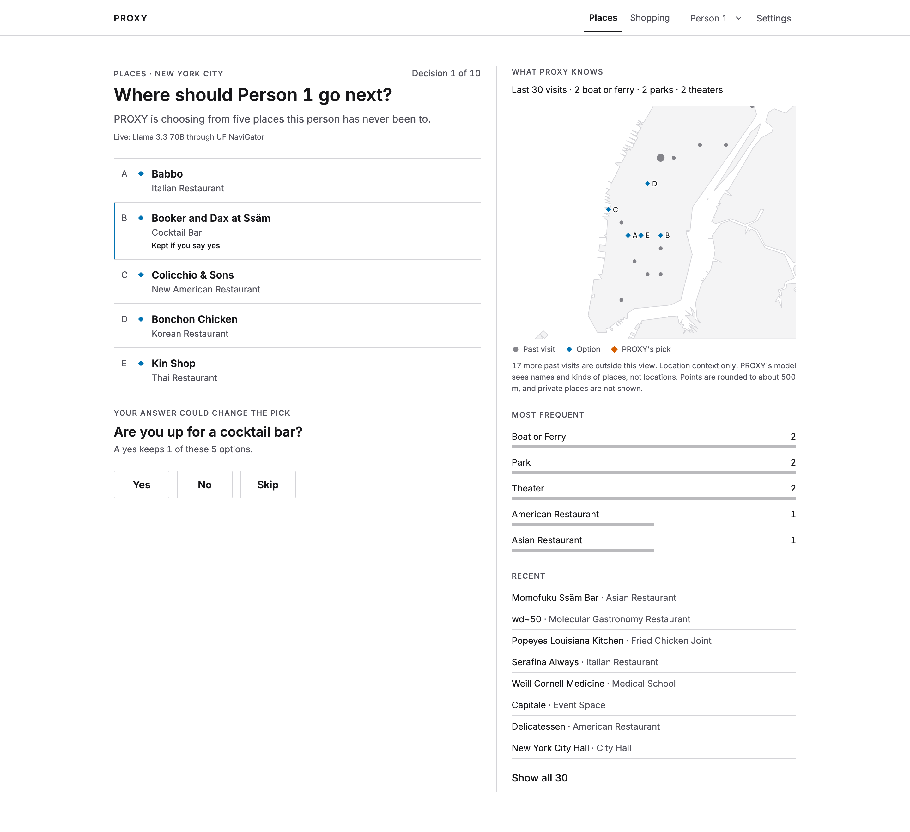
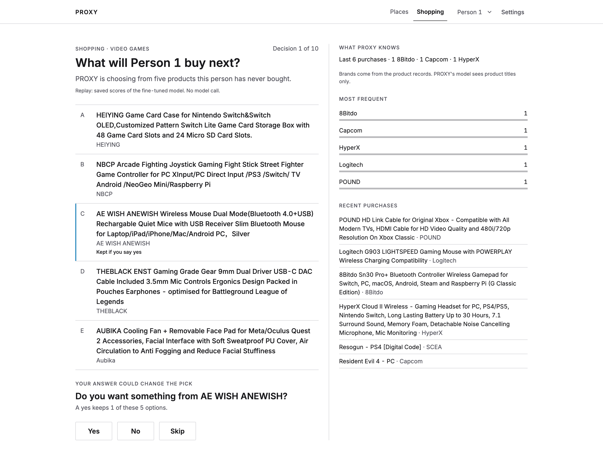
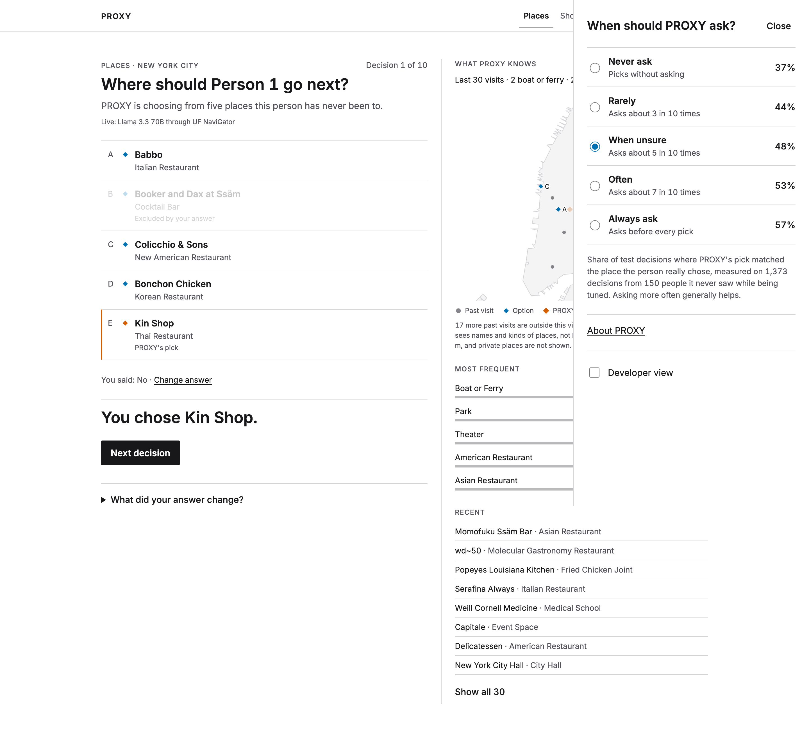
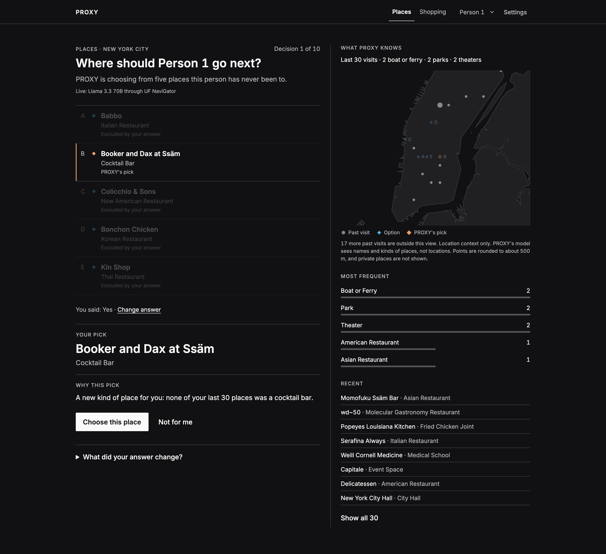
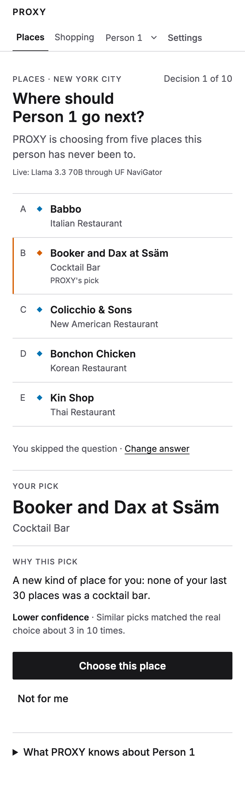

# PROXY: predicting a person's next new place from their check-in history

PROXY is the semester project for EGN 6216 AI Systems (University of Florida, Fall 2026). It asks how well an AI system that
acts on someone's behalf can predict the choice that person would make. The test is concrete: given a person's earlier
check-ins, pick the new venue they actually visit next from five options. The four wrong options are matched to the answer on
popularity, so popularity alone cannot give the answer away.

## Repository

| path | contents |
|---|---|
| `playground.ipynb` | downloads the dataset, verifies it and takes a first look at it |
| `src/proxy/` | data loading, the per-user split, the five-option questions, their prompts, and paired per-user statistics |
| `src/proxy/config.py` | the canonical configuration, the one place the defaults come from |
| `hpc/` | scripts that write the question files, build the other-person control, and train the model adapter on a GPU cluster |
| `hpc/build_matched_stranger.py` | writes the matched-stranger control: each user's history is replaced by that of the most similar other user (same history length band, closest category profile), with no random draw |
| `hpc/requirements_hpc.txt` | pinned packages of the cluster environment that ran the GPU jobs |
| `tests/` | tests that run on a small synthetic release |
| `app/` | the delegate interface (React): a live client of the API that picks a place, asks one question when that helps, and says how far the pick can be trusted |
| `api/` | the service behind the interface (FastAPI): it calls the hosted model for each new decision and applies the ask rule; see `api/README.md` |
| `docs/` | screenshots of the interface and the script that captures them |
| `experiments/m4/` | the comparison of candidate models, the calibration step, the ask-rule comparison and the export of the interface data |
| `proposal/milestone3/` | the statistics and checks reported in the Milestone 3 data document |
| `requirements.txt` | Python packages for the notebook |

## Live demo



The interface has two parts. Places works on 105 held-out decisions of 12 people. For each decision the API sends the person's 30 most recent places
and the five options to Llama 3.3 70B Instruct, hosted on HiPerGator and reached through UF NaviGator. The model returns the
probability of each option. If one yes or no question about a kind of place would raise the chance of a right pick by enough,
PROXY asks it first; the answer removes the options it rules out. The pick comes with a reason taken from the person's own
history and a measured track record.

The numbers in the interface come from the same model over all 2,502 held-out decisions of the 300 test people. Half of the
people set the model's calibration and the ask thresholds; the other half (1,373 decisions from 150 people) give the reported
numbers, with 95% intervals from a person-level bootstrap. Questions are answered truthfully from the real choice.

| when PROXY asks | asks on | pick matches the real choice |
|---|---|---|
| Never ask | 0% | 36.7% [33.2, 40.3] |
| Rarely | 31% | 43.9% [40.6, 47.5] |
| When unsure | 50% | 47.9% [44.7, 51.4] |
| Often | 71% | 52.7% [49.6, 56.2] |
| Always ask | 100% | 56.9% [53.6, 60.3] |

A random pick matches one time in five. The calibration error of the model's confidence is 0.021. A model call takes 0.28 s
at the median and 0.45 s at the 90th percentile.

Shopping works on 62 held-out purchase decisions of 12 people (Amazon Reviews 2023, video games). It replays the saved scores
of the fine-tuned Llama-3.1-8B-Instruct, so it makes no model call, and asks about a brand or category. On the 3,995 decisions
of the 1,805 report people among all 8,000:

| when PROXY asks | asks on | pick matches the real purchase |
|---|---|---|
| Never ask | 0% | 62.8% [60.8, 64.8] |
| Rarely | 29% | 71.9% [70.1, 73.8] |
| When unsure | 47% | 75.6% [73.9, 77.3] |
| Often | 67% | 79.0% [77.5, 80.5] |
| Always ask | 100% | 80.8% [79.3, 82.3] |

To run it, start the API and then the interface:

```
cd api && cp .env.example .env    # add a NaviGator key
python3 -m pip install -r requirements.txt
python3 -m uvicorn app:app --port 8787
cd ../app && npm install && npm run dev    # then open http://localhost:5174
```

| | |
|---|---|
|  |  |
|  |  |
|  |  |

The API tests (`cd api && python3 -m pytest -q test_api.py`) cover valid, edge and malformed input, every model failure, the
rate and size limits, the logs and the key. The interface tests run with `cd app && npm test`.

## Data

Massive-STEPS New York (Wongso et al., 2025, arXiv 2505.11239), published on Hugging Face as
[`CRUISEResearchGroup/Massive-STEPS-New-York`](https://huggingface.co/datasets/CRUISEResearchGroup/Massive-STEPS-New-York)
under the Apache 2.0 license. The project uses the full check-in file `new_york_checkins.csv`: 272,368 check-ins from 6,929
users at 45,804 venues, collected in 2012-13 and 2017-18.

| item | value |
|---|---|
| revision | commit `1e6af440a88ee54c83b1e30930290699e194a726` |
| SHA-256 | `edc194f732cb236d841dbee775000c40d9e69bd9668c0aeebf266a159167b3a6` |
| license | Apache 2.0, with upstream sources Semantic Trails (CC0 1.0) and Foursquare Open Source Places (Apache 2.0) |
| retrieved | first on August 31, 2026, and re-verified by the notebook on October 5, 2026 |

Apart from the interface sample described below, the repository holds no data. The notebook downloads the file and checks its
checksum. To run the code in `src/` and `hpc/`, place the release under `data/massive_steps/new_york/` or point
`PROXY_DATA_ROOT` at a folder with that layout.

Venue histories can identify a person. The code and documents show no user id, no exact time and no coordinates. The
exceptions are the interface samples in `app/public/data/`: `places.json` holds 105 held-out decisions of 12 people,
each with that person's recent places, under the dataset's Apache 2.0 license, and `shopping.json` (used by the Milestone 4 interface, not the live one) holds 62 held-out
purchase decisions of 12 people from Amazon Reviews 2023 (video games), with product titles only. In that file user ids are replaced by "Person 1" to
"Person 12", homes carry no name, and places that reveal health, religion, sexual orientation or a residence are shown only
by a generic label such as "Health care" or "Place of worship". See `app/public/data/NOTICE.md`.

## Model

Llama-3.1-8B-Instruct from Meta, published on Hugging Face as
[`meta-llama/Llama-3.1-8B-Instruct`](https://huggingface.co/meta-llama/Llama-3.1-8B-Instruct), revision
`0e9e39f249a16976918f6564b8830bc894c89659`. It is released under the Llama 3.1 Community License and Meta's Acceptable Use
Policy. Access is gated: each user accepts the license on Hugging Face before downloading. The repository holds no model
weights; the scoring script loads the model by name and revision.

## Canonical configuration

`src/proxy/config.py` holds one configuration. Every entry point reads its defaults from it, so a call that names no option
builds the canonical question file. Every model is scored on that one file.

| setting | value |
|---|---|
| `dataset` | `steps_new_york` |
| `distractors` | `popmatched` |
| `n_users` | 300 |
| `seed` | 0 |
| `hist_n` | 30 |
| `hist_order` | `recent` |
| `k` | 5 |

To write the file:

```
PYTHONPATH=src python hpc/build_targets.py --out results/targets/steps_new_york_popmatched.jsonl
```

Building it again from the same release gives the same bytes.

## How a prediction question is built

- Users with at least 20 check-ins are kept, and the last 20% of each user's check-ins are held out for testing.
- A user's check-ins are ordered by time. Two check-ins of one user with the same timestamp are ordered by venue id. The New
  York release has one such pair among its 272,368 check-ins.
- Each question is one held-out visit to a place the user had never been before.
- The five options are that place and four decoys. A decoy comes from the same popularity band as the answer, or from a
  neighbouring band when that band has too few venues, and never from the user's own history. Popularity is the number of
  check-ins that kept users made before their split, and the venues are cut into 20 bands by it.
- The system sees the user's 30 most recent earlier check-ins and picks one of the five options.

## Decoy conditions

The condition is chosen with `distractors`. It is always named beside any number.

| condition | how the four decoys are drawn |
|---|---|
| `popmatched` | the canonical condition, described above |
| `textmatched` | the harder condition. A decoy also comes from the same genericness band as the answer, so the answer cannot be picked because its text reads as more specific. The scores come from a JSON table passed as `genericness_path` to `proxy.task.build`. The table is not part of this repository |
| `popmatched_period` | optional and off unless named. A decoy also has the answer's pre-cut period profile and a check-in in the question's period |
| `popular` | the city's most visited venues. It gives the answer away and serves only as a reference |

The release covers two periods, 2012-13 and 2017-18. The canonical condition does not look at them, so a decoy can come from
the other period. `popmatched_period` closes that gap for every question. The pre-cut period profile of a venue says in which
periods a kept user checked in there before their split: only 2012-13, only 2017-18, both, or neither. If no decoy pool
qualifies for a question, the question is dropped and `fallback_stats` of `proxy.task.build` counts it. The profile is never
relaxed. To write the file:

```
PYTHONPATH=src python hpc/build_targets.py --distractors popmatched_period --out results/targets/steps_new_york_popmatched_period.jsonl
```

## Run

```
pip install -r requirements.txt
jupyter nbconvert --to notebook --execute --inplace playground.ipynb
python -m unittest
```

The tests use a small synthetic release. The checks of the sequence models need `torch` and are skipped without it.
Training the adapter on a GPU needs the packages pinned in `hpc/requirements_hpc.txt`: torch, transformers, peft, vLLM and
the CUDA 13.0 runtime.

Tested with Python 3.12.7.
