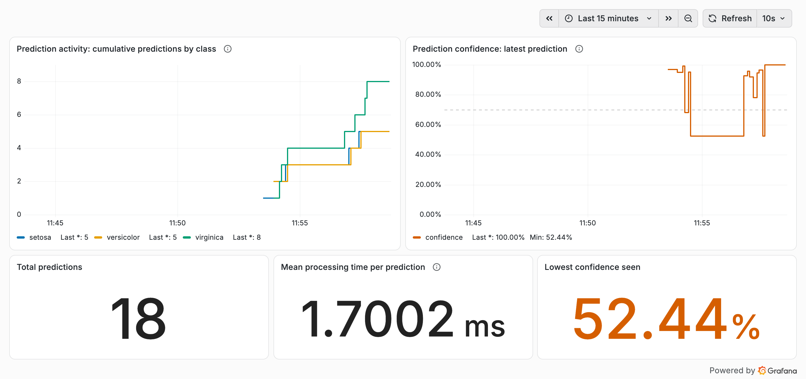

# Module 8: Deployment and Monitoring

Mustafa Sameen, EGN 6216

The report is [Module8_Deployment_Monitoring_Sameen.pdf](Module8_Deployment_Monitoring_Sameen.pdf).

## What runs

A Gradio app serves an Iris classifier, a support vector machine with a linear kernel. The app exposes Prometheus metrics on port 8000. Prometheus scrapes them every 5 seconds, and Grafana shows them on a dashboard.

| File | Purpose |
|---|---|
| `app.py` | Gradio app and Prometheus metrics |
| `Dockerfile` | Image for the app |
| `docker-compose.yml` | App, Prometheus and Grafana |
| `prometheus.yml` | Scrape configuration |
| `grafana_dashboard.json` | Dashboard export |
| `screenshots/` | Prometheus target page and Grafana dashboard |

To run it:

```bash
docker-compose up --build
```

- Gradio: http://localhost:7860
- Prometheus: http://localhost:9090
- Grafana: http://localhost:3000. Import `grafana_dashboard.json` with Prometheus at http://prometheus:9090 as the data source.

## Prometheus target


The gradio-app target at http://gradio-app:8000/metrics is UP.

## Grafana dashboard



The screenshot was taken after 18 test predictions made through the Gradio app.

- **Prediction activity.** The running total of predictions for each species, from `gradio_predictions_total` summed by class.
- **Prediction confidence.** The model's probability for the species it chose on the most recent prediction, from `gradio_prediction_confidence`. The dashed line at 70% marks low confidence.
- **Total predictions.** The sum of all prediction counts.
- **Mean processing time per prediction.** `request_processing_seconds_sum` divided by `request_processing_seconds_count`.
- **Lowest confidence seen.** The minimum confidence in the last 30 minutes.

## Observation

Typical flowers were classified with 92 to 100% confidence. Confidence fell near the boundary between versicolor and virginica. The two most borderline inputs, (6.3, 2.5, 4.9, 1.5) and (6.2, 2.8, 4.8, 1.8), were labeled virginica with about 52% confidence. The mean processing time was 1.7 ms per prediction after 18 predictions.
